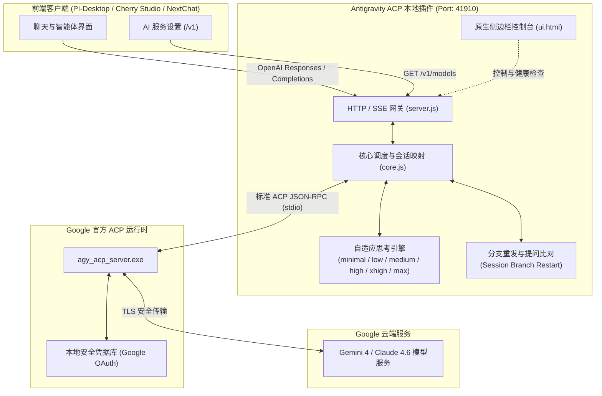

# Antigravity ACP 网关 (PI-Desktop 插件)

<p align="center">
  
</p>

<p align="center">
  <strong>将 Google 官方 Antigravity ACP 运行时无缝转换为标准 OpenAI 兼容的本地高性能 API 网关</strong>
</p>

<p align="center">
  <a href="https://github.com/sedirk/antigravity-acp-pidesktop/releases"></a>
  <a href="LICENSE"></a>
  
  
  
</p>

---

**2.4.0（默认运行时 `agy-acp-server 1.5.2`）：** 默认官方运行时升级至 **`1.5.2`**（支持从 `1.3.0` / `1.5.0` 一键平滑升级），原生适配 **`gemini-4-neon`** 与 **`gemini-4-hydrogen`**（底层 `-extra_high` 双向映射为标准 `xhigh` 档位，兼容 CCPA 三档映射与 `configOptions` 目录），对齐 `1.5.2` 会话恢复 `currentModelId` 同步、`-32602` 非法模型快速失败及取消/断连合成块分级处置；同时重构上下文压缩与续接全链路（默认 `reportedMaxTokens=32768` 恢复 `256K` 模型 `~200.9K` 自动压缩线、统一字符+UTF-8 字节双预算并前置 `CONTEXT_BUDGET_EXCEEDED` 无损预检、分离非截断型分支摘要、补齐 `/v1/responses` `previous_response_id` 增量工具交付续接、加固显式键隔离与按请求原子签名提交及失效足迹记忆保留），并完整保留输入框工具栏上下文计量插槽（`agent/budget-status-240.mjs`）。见[工具栏读数](docs/CONTEXT-METER.md)，`/acp-context` 仍可使用；若在 **PI-Desktop `v0.23.0`** 上希望将实时水位合并进宿主原生底栏单圆环，可使用 Release 附带的[可选一键宿主补丁](#4-可选pi-desktop-v0230-原生单圆环一键补丁)。

## 📑 目录

- [🌟 为什么选择 Antigravity ACP](#-为什么选择-antigravity-acp)
- [🏗️ 系统架构](#️-系统架构)
- [🚀 快速上手](#-快速上手)
  - [1. 安装插件](#1-安装插件)
  - [2. 初始化运行时与一键登录](#2-初始化运行时与一键登录)
  - [3. 在 PI-Desktop 中接入服务](#3-在-pi-desktop-中接入服务)
  - [4. （可选）PI-Desktop v0.23.0 原生单圆环一键补丁](#4-可选pi-desktop-v0230-原生单圆环一键补丁)
- [🧠 深度思考与思维链自适应体系](#-深度思考与思维链自适应体系)
  - [支持模型总览](#支持模型总览)
  - [全新 Gemini 4 Neon / Hydrogen 与 xhigh 档位](#全新-gemini-4-neon--hydrogen-与-xhigh-档位)
  - [自适应思考工作机制](#自适应思考工作机制)
- [🛠️ 核心功能亮点](#️-核心功能亮点)
  - [打断重新编辑与分支重发保障](#打断重新编辑与分支重发保障)
  - [双向工具集成与宿主工具回交](#双向工具集成与宿主工具回交)
  - [PID 进程树清理与后台自愈](#pid-进程树清理与后台自愈)
  - [原生侧边栏管理控制台](#原生侧边栏管理控制台)
- [⚙️ 配置参数详解](#️-配置参数详解)
- [📡 API 端点规范](#-api-端点规范)
- [❓ 常见问题排查 (FAQ)](#-常见问题排查-faq)
- [上下文核验、有界记忆与账号风险](docs/CONTEXT-AND-RISK.md)
- [🧪 本地开发与测试](#-本地开发与测试)
- [📄 开源协议](#-开源协议)

---

## 🌟 为什么选择 Antigravity ACP

Google Antigravity 官方运行时（`agy_acp_server.exe`）拥有强大的智能代理执行、深度思维链和长上下文能力。然而官方通常绑定庞大的客户端，缺少标准的 HTTP API 协议暴露。

**Antigravity ACP 网关插件**应运而生：
- 🔒 **本地私密安全**：**不逆向私有接口，不上传或劫持 Token**，所有凭据由 Google 官方二进制在本地安全保管。
- 📦 **免装官方客户端**：内置极简自动化下载与校验机制，无需在电脑上预装数十 GB 的臃肿桌面客户端。
- ⚡ **原生标准适配**：对外统一提供标准的 `/v1/responses` 与 `/v1/chat/completions` 接口，无缝接入 PI-Desktop、Cherry Studio 等生态工具。
- 🧠 **思维链自适应**：原生适配 `1.5.2` 最新 **Gemini 4 Neon / Hydrogen（支持 xhigh 极限思考）**、Carbon、Argon 及 Claude 系列，自动解析并下发精确思考深度。

---

## 🏗️ 系统架构



---

## 🚀 快速上手

### 1. 安装插件

1. 前往 [Releases 发布页面](https://github.com/sedirk/antigravity-acp-pidesktop/releases) 下载最新版本的 `.piplug` 安装包（如 `local.antigravity-acp-2.4.0.piplug`）。
2. 在 **PI-Desktop** 中打开 **设置** → **插件**。
3. 点击右上角 **从本地安装**，选择刚下载的 `.piplug` 文件。
4. 安装完成后，插件后台将自动初始化并在默认端口 `41910` 启动网关服务。

### 2. 初始化运行时与一键登录

首次使用时，只需两步即可完成就绪：

1. **打开控制台**：在 PI-Desktop 右侧边栏中点击 **Antigravity ACP** 图标（或在插件详情中点击“打开控制台”）。
2. **下载运行时**：若“运行时状态”显示未就绪，点击顶部显目的 **一键初始化运行时** 按钮，网关将自动下载轻量级二进制文件并校验 SHA256。
3. **Google 授权登录**：点击 **一键登录 Google**，系统将自动调起默认浏览器访问 Google 官方授权页；授权成功后，状态将自动跳变为 **已就绪**。

> [!TIP]
> 插件右侧边栏内置了**一键刷新检测**与**自动检测就绪**机制，控制台打开时会自动探活，无需反复重启软件。

### 3. 在 PI-Desktop 中接入服务

进入 PI-Desktop 的 **偏好设置** → **模型** → **添加服务**：

| 参数项 | 推荐填入值 | 说明 |
| :--- | :--- | :--- |
| **服务类型** | `自定义端点` | 标准兼容模式 |
| **名称** | `gemini` 或 `Antigravity ACP` | 本地显示名称 |
| **接口地址** | `http://127.0.0.1:41910/v1` | **必须带 `/v1` 后缀** |
| **API 密钥** | `sk-local`（或任意字符） | 本地网关默认免鉴权 |
| **接口格式** | **`OpenAI Responses`** *(强烈推荐)* | 完整支持原生思维链、长会话与工具回交 |

> [!IMPORTANT]
> **关键步骤：配置完成后，请务必点击右侧的「获取列表」按钮勾选模型并保存服务！**
> 点击后客户端将从网关同步全部模型元数据（包括 `gemini-4-neon`、`gemini-4-hydrogen`、默认上下文规格及 `xhigh` 思考档位；推荐从「获取列表」勾选添加）。
> - **默认上下文：256K（256000 Token）**，GPT-OSS 为 128K（131072 Token）。上游会自行摘要压缩。
> - **已有 Gemini / Claude 模型**：在「设置 → 模型」将上下文改为 `256000` 并保存。仅刷新列表不会覆盖已保存的窗口。

### 4. （可选）PI-Desktop v0.23.0 原生单圆环一键补丁

插件默认**无需任何宿主补丁即可完整运行**（通过输入框工具栏独立胶囊展示预算与上游水位，详见[工具栏读数](docs/CONTEXT-METER.md)）。由于向 PI-Desktop 上游提交的两项最小扩展能力 PR（`#2451` 进程内 `contextRequestId` 请求配对与 `autoCompactAt` 压缩线只读暴露、`#2452` `ctx.ui.setProviderContext` 分子联动校准）尚未合入官方主线，[v2.4.0 Release](https://github.com/sedirk/antigravity-acp-pidesktop/releases/tag/v2.4.0) 额外提供了面向官方 **Windows 版 PI-Desktop `v0.23.0`** 的一键补丁包 **`local-host-patch-0.23.0.zip`**（同时附带完整源码审阅补丁 `pi-desktop-v0.23.0-native-context-minimal.patch`）：

- **补丁效果**：安装后，`Antigravity ACP v2.4.0` 会自动检测宿主 `ctx.ui.setProviderContext` 接口，将长工具链期间的上游实测水位经分子联动校准直接写入宿主原生底栏圆环，并自动收起右侧重复胶囊，实现**原生单圆环合一**。
- **安全与最小影响**：仅校准输入框显示的分子 `budget.tokens` 与圆环百分比，**绝不修改**分母 `budget.hardLimit`、外发 HTTP 请求或 Token 计费账本（内置会话/模型隔离、失败回滚、压缩检查点隔离及 85% 原始文本安全下限）；不使用本插件的其他模型服务体验与官方原版 `v0.23.0` 100% 一致。

#### 一键安装方法

1. 前往 [v2.4.0 Release 页面](https://github.com/sedirk/antigravity-acp-pidesktop/releases/tag/v2.4.0) 下载 **`local-host-patch-0.23.0.zip`**，完整解压到任意本地文件夹（勿直接在压缩包预览窗口内双击运行）。
2. 先保存或结束 PI-Desktop 中正在执行的对话任务。
3. 双击运行解压目录中的 **`install-patch.cmd`**：
   - 脚本会自动定位 `C:\Program Files\PI-Desktop`、`%LOCALAPPDATA%\Programs\PI-Desktop` 或注册表记录的安装目录（若安装在系统目录，会自动弹出 UAC 请求管理员权限）；
   - 安装前会逐一强校验包内全部 335 个载荷文件的 `SHA256SUMS.txt`，并严格核验目标宿主版本必须为官方 **`0.23.0`**（若检测到非 `0.23.0` 版本会立即安全中止，不修改任何文件）；
   - 自动将原版文件备份为 `*.pre-native-context-0.23.0.bak`，原地合成补丁版 `app.asar` 并同步更新 `PI-Desktop.exe` 的 Electron ASAR Header SHA-256 完整性签名，随后自动重启 PI-Desktop。
   - 若安装在自定义路径且未被自动识别，可在解压目录打开 PowerShell 指定路径执行：
     ```powershell
     powershell -ExecutionPolicy Bypass -File .\install-patch.ps1 -InstallDir "D:\你的路径\PI-Desktop"
     ```
4. **插件联动**：若当前电脑已安装 `Antigravity ACP v2.4.0+`，重启后自动启用原生单圆环（若仍为 `v2.3.9` 也会自动同步兼容桥接脚本）；若在另一台新电脑上首次部署，补丁包内的 `plugin\local.antigravity-acp-2.4.0.piplug` 可直接在「设置 → 插件 → 从本地安装」导入（记得开启 `agent.extension` 与 `renderer.extension` 权限）。

#### 环境预检与一键无损回滚

- **仅预检不写入**：运行 `powershell -ExecutionPolicy Bypass -File .\install-patch.ps1 -CheckOnly` 可在不改动任何宿主文件的前提下核验版本与文件哈希。
- **一键恢复原版**：双击运行解压目录中的 **`rollback-patch.cmd`**，即可从 `*.pre-native-context-0.23.0.bak` 备份无损还原至官方原版 `v0.23.0` 并自动重启（后续升级官方 `0.24.0+` 新版时，直接覆盖安装官方安装包或先双击一次 `rollback-patch.cmd` 均可）。
---

## 🧠 深度思考与思维链自适应体系

### 支持模型总览

网关启动后通过虚拟模型引擎自动归一化底层模型（含 `models.availableModels` 与 `configOptions`），提供精准的上下文与思考档位定义：

| 虚拟模型 ID | 显示名称 | 默认上下文通告 | 最大输出 | 思考档位支持 | 适用场景 |
| :--- | :--- | :---: | :---: | :--- | :--- |
| `gemini-4-neon` | **Gemini 4 Neon** *(1.5.2 新增)* | **256,000** (256K) | **65,536** (64K) | `low`, `medium`, `high`, **`xhigh`** | 高阶智能体编排、复杂工程重构、深度思考推理 |
| `gemini-4-hydrogen` | **Gemini 4 Hydrogen** *(1.5.2 原生)* | **256,000** (256K) | **65,536** (64K) | `low`, `medium`, `high`, **`xhigh`** | 极深逻辑推演、重大架构设计、超长链代码编写 |
| `gemini-4-carbon` | Gemini 4 Carbon | 256,000 (256K) | 65,536 (64K) | `low`, `medium`, `high` | 强推理旗舰模型、工程级代码落地 |
| `gemini-4-argon` | Gemini 4 Argon | 256,000 (256K) | 32,768 (32K) | `low`, `medium`, `high` | 通用对话、轻度代码、日常任务平衡之选 |
| `gemini-3.8-flash` | Gemini 3.8 Flash | 256,000 (256K) | 65,536 (64K) | `low`, `medium`, `high` | 毫秒级极速响应、文档总结、日常高频辅助 |
| `claude-sonnet-4-6` | Claude Sonnet 4.6 (Thinking) | 256,000 (256K) | 131,072 (128K) | `low`, `medium`, `high` | 精致文学撰写、复杂指令跟随、混合思维链 |
| `claude-opus-4-6-thinking` | Claude Opus 4.6 (Thinking) | 256,000 (256K) | 131,072 (128K) | `low`, `medium`, `high` | 深度复杂推理、高难度综合分析 |
| `gpt-oss-120b` | GPT-OSS 120B | 131,072 (128K) | 32,768 (32K) | *不支持思考* | 开源大参数基座测试与实验对比 |

> 注：实际可见模型取决于当前认证方式与订阅等级；表中为插件默认通告，自定义值不改变上游预算。
---

### 全新 Gemini 4 Neon / Hydrogen 与 xhigh 档位

`agy-acp-server 1.5.2` 原生内置 **`gemini-4-neon`** 与 **`gemini-4-hydrogen`** 两大模型家族，均支持超高预算深度思考（底层 wire 后缀 `-extra_high`，网关双向标准映射为 `xhigh`）：

1. **自动聚合与精确下发**：底层运行时的 `-low` / `-medium` / `-high` / `-extra_high`（以及 `-xhigh`、`-max`、`-effort` 与 CCPA 历史别名）会被网关自动聚合为单一虚拟主模型，并在 `session/set_model` 时精确还原为运行时声明的真实 wire ID，彻底避免发送未声明后缀触发 `-32602`。
2. **档位完整性**：向客户端完整导出 `low`、`medium`、`high`、`xhigh` 四档思考深度（按低到高有序排列），在 PI-Desktop 的模型思考选择器中可直接自由切换。
### 自适应思考工作机制

网关内置的 **Adaptive Thinking Engine** 具备以下核心能力：

```
                客户端请求传入
       (reasoning_effort / thinking 档位)
                     │
                     ▼
       ┌───────────────────────────┐
       │ 检查目标模型是否支持思考能力？│
       └─────────────┬─────────────┘
                     │
           ┌─────────┴─────────┐
           ▼ 是                ▼ 否
   ┌───────────────┐     ┌───────────────┐
   │ 当前档位是否支持？ │     │ 忽略思考参数   │
   └───┬───────┬───┘     │ 以普通模型发送 │
       │ 是    │ 否      └───────────────┘
       ▼       ▼
┌───────────┐ ┌─────────────────────────────────────────┐
│直接命中档位│ │智能就近对齐降级：                       │
│(如 xhigh) │ │- 请求 xhigh 但仅支持 high -> 降级为 high │
└───────────┘ │- 请求 minimal 但仅支持 low -> 升级为 low │
              └─────────────────────────────────────────┘
```

- **协议声明**：在 `/v1/models` 输出中显式标注 `thinkingProtocol: "adaptive"`，告知前端自动启用自适应思维链，无需用户编写复杂的 Prompt 强行触发思考。
- **平滑兼容**：不管是 OpenAI Responses 的 `reasoning.effort` 还是 Chat Completions 的 `reasoning_effort`，网关均能无损提取与映射。
- **思考流实时还原**：在 SSE 响应流中以 `reasoning_content` 和 `reasoning_summary_text.delta` 格式输出，客户端思考面板实时展开。

---

## 🛠️ 核心功能亮点

### ⚡ 前缀缓存对齐（Prefix Cache Alignment）与 TPU 提速
- **工具 Schema 确定性排序**：无论客户端以何种顺序传入 tools，网关内部严格按名称进行字母排序（`pi-bridge_*`），确保工具定义的前缀在字节级绝对稳定，最大化激发云端 TPU 集群的 **Prefix Caching**（复用率提升 5~10 倍）。
- **首轮系统锚定与续会话免重复**：工具引导词只在首轮新建会话时作为固定系统锚点注入；在长轮次对话与工具回填时，网关自动跳过重复注入，既杜绝会话上下文膨胀，又保证多轮会话的 KV Cache 持续稳定命中。
- **全链路格式标准化**：全自动规范化各轮消息的换行符（统一对齐为 `\n`）与多余空行，避免因平台差异（Windows CRLF vs POSIX LF）引起 BPE 分词器分裂从而击穿云端前缀缓存。

### 打断重新编辑与分支重发保障

在实际对话中，如果回答不符合预期，用户常常会**点击停止**并**重新编辑刚刚发送的问题**（在 PI-Desktop 中表现为生成版本切换，如 `< 2 / 2 >`）。

- **传统网关的痛点**：旧会话在后台仍然挂起，重新编辑后的内容被当作追加轮次，导致上下文污染甚至报错。
- **本网关解决方案**：引入提问签名比对与分支重置引擎。当检测到相同位置的提问发生变更时，自动平滑重置旧会话并重开上下文，保证模型 **100% 完整接纳最新修改的内容**。

### 双向工具集成与宿主工具回交

- **内置工具支持**：网络搜索（Google Search）、代码环境执行等。
- **Host Tools Bridge（宿主回交）**：当 PI-Desktop 自身带有工具定义（如桌面读取、MCP 工具等）时，网关可将工具调用请求优雅交回给 PI-Desktop 宿主执行，形成强大的执行闭环。

### PID 进程树清理与后台自愈

Windows 环境下后台常驻进程（`agy_acp_server.exe` / `localharness_external.exe`）容易因为插件热重载或崩溃变为“僵尸孤儿进程”并锁死端口。
网关每次启动时通过系统底层进程树拓扑检测，**彻底终结旧进程树**，保证服务百分之百平滑自愈。

### 原生侧边栏管理控制台

适配 PI-Desktop 侧边栏微型视图与全屏视图：
- **置顶快捷区**：运行时状态检测、一键下载初始化、一键 Google 浏览器免密登录置于最醒目位置。
- **工作区智能跟随**：工作目录留空时，网关默认实时跟随 PI-Desktop 当前工作空间，执行终端命令无需手动切换路径。

---

## ⚙️ 配置参数详解

配置文件保存在插件数据目录下的 `config.json` 中，可通过右边栏控制台可视化修改：

| 配置键 | 默认值 | 可选值 / 格式 | 详细说明 |
| :--- | :--- | :--- | :--- |
| `port` | `41910` | 1024 - 65535 | 本地网关监听的 HTTP 端口 |
| `toolPolicy` | `"all"` | `"all"`, `"shell"`, `"search"`, `"none"` | 工具权限放行策略（全部放行 / 仅命令 / 仅搜索 / 纯对话） |
| `proxyMode` | `"system"` | `"system"`, `"manual"`, `"direct"` | 网络代理模式（自动探测 Windows 系统代理 / 手动 / 直连） |
| `proxyUrl` | `""` | `http://127.0.0.1:7890` | 手动代理地址（当 `proxyMode` 为 `manual` 时生效） |
| `cwd` | `""` | 绝对路径或留空 | 工作目录。**留空代表实时跟随 PI-Desktop 当前打开的项目工程** |
| `enableHostToolsBridge`| `true` | `true` / `false` | 是否开启 PI-Desktop 宿主工具直连回交 |
| `virtualModels` | `true` | `true` / `false` | 是否启用虚拟模型归一化（聚合思考档位，避免列表散乱） |
| `defaultEffort` | `"medium"` | `"minimal"`, `"low"`, `"medium"`, `"high"`, `"xhigh"` | 客户端未指定思考深度时的全局默认档位 |
| `idleTimeoutMs` | `600000` | 毫秒数值（默认 10分钟） | 后台长连接会话空闲回收超时 |
| `reportedContextWindow` | `0` | `0` 或正整数 Token | 默认 `0` 时通告 `256000`（`gpt-oss-120b` 为 `131072`）；填写非零值按自定义通告保留。自定义通告不改变上游预算 |
| `reportedMaxTokens` | `0` | `0` 或 `1` - `262144` | 默认 `0` 时通告 `32768`，避免宿主扣减 `64K` 输出预留导致在 ~172.8K 过早自动压缩；ACP 实际输出不受此值截断 |
| `highContextThrottleTokens` | `160000` | 非负整数 Token | 可选的高上下文微节流触发阈值，**不是**模型上下文容量上限 |
| `highContextThrottleMs` | `0` | 毫秒数值（`0` - `30000`） | 达到阈值且连续工具回填第 4 步起的每步额外等待（至少 150ms 生效）。v2.3.4 默认 `0`，保留已保存的非零值；升级后仍显示非零时，可手动设为 `0` 并保存。v2.3.3 曾默认 `2500` |
| `mcpMaxOutputBytes` | `262144` | 字节数（默认 256 KiB） | 单次 MCP/工具输出字节数上限，非模型上下文容量 |

### 延迟与上下文数字诊断（`[acp-diag]`）

v2.3.4 新增默认启用、无正文的 `[acp-diag]` JSON 行诊断，仅记录数字、布尔值、固定枚举和哈希/随机 `trace` / `session` / `lane` 及 `step`（不包含提示词、工具参数、工具结果、报告或密钥；常数状态维护，不保存历史数组）。该隐私范围仅针对新增诊断行，不代表所有既有日志都无正文：

- **事件类型**：`dispatch`、`first_progress`、`park`、`resume`、`context`、`context_final`、`end`。
- **耗时字段归因**：`throttleMs`（实际额外等待，默认 `0`，非零表示存在已保存的非零配置）、`hostRoundTripMs`（含工具执行、用户等待及宿主/HTTP 往返，**不是纯工具耗时**）、`localResumeMs`（本地回填处理，包含 `throttleMs`，两者不能相加）、`waitMs`（首次派发或工具结果回交后至首次可见模型活动，仍含传输与上游等待，**不是纯模型生成速度**）。
- **上下文字段归因**：`rawUsed` / `rawSize`（官方 `usage_update` 原始字段）、`beforeUsed` / `pendingBefore` 与 `reportedUsed` / `pendingAfter`（桥接处理值）、`rawInputTokens` / `rawCachedReadTokens`（终态累计输入，不直接等于当前上下文占用）。插件保留官方回落，不强行钳值或据此重建。

---

### Usage 映射（2.3.6）

上下文水位不再冒充标准输入。只透传作用域可确认的完整未拆分终态计数；工具链中缺少可靠逐步明细时省略标准用量，保留水位、可见输出估计和官方整轮汇总供诊断。宿主沿用自身历史预算，token/cache UI 可能显示缺失或 0，不代表真实命中为零。另修复 Chat 挂起重复发送正文。详见 [映射合同、同条件对照与限制](docs/USAGE-MAPPING.md)。无需修改宿主；升级后建议用新对话验收，旧错误样本不会被自动改写。

## 📡 API 端点规范

网关在本地启动后，完全符合标准的 RESTful 协议：

- **`GET /v1/models`**
  返回当前支持的所有模型及元数据列表。包含上下文窗口大小（`context_window`）、最大输出 Token（`max_tokens`）、思考档位数组（`thinkingLevels`）以及协议标识（`thinkingProtocol: "adaptive"`）。
- **`POST /v1/responses`**
  OpenAI Responses 流式端点，推荐在智能代理及长上下文工具交互场景使用。
- **`POST /v1/chat/completions`**
  OpenAI Chat Completions 聊天端点，兼容通用大模型客户端。
- **`GET /health`**
  网关与底层 ACP 运行时的健康探针端点。

---

## ❓ 常见问题排查 (FAQ)

### Q1: 在模型配置界面看到部分模型显示 `--- · ---`，思考模式没有出现？
> **解答**：这是因为 PI-Desktop 客户端缓存了旧的列表缓存。
> 1. 打开 **设置** → **模型** → 点击编辑你的 **Antigravity 服务**；
> 2. 点击左下角的 **「获取列表」** 按钮；
> 3. 客户端即可拉取到最新的模型上下文大小（如 256K · 32K）和 `xhigh` 思考档位支持！

### Q2: 侧边栏一直处于“检测中”，点击刷新才有反应？
> **解答**：最新版本已全面修复该问题。插件在面板挂载时会自动触发一轮无阻塞健康轮询，若后台初始化较慢，只需保持面板开启即可在就绪后自动跳绿。

### Q3: 国内环境如何配置网络代理？
> **解答**：
> 1. 如果你在系统上开启了代理软件，网关默认配置 `proxyMode: "system"` 会自动捕获 Windows 注册表中的系统代理设置。
> 2. 如果使用局域网代理或特定端口，打开侧边栏控制台，将“代理模式”改为 **手动指定**，并在下方填入 `http://127.0.0.1:你的端口`，点击保存即可即时生效。

### Q4: 如何在 Cherry Studio / NextChat 等第三方软件中使用？
> **解答**：
> 接口地址填入 `http://127.0.0.1:41910/v1`，API Key 填入 `sk-local`，格式选 OpenAI 即可。

---

## 🧪 本地开发与测试

本项目提供离线与模拟 ACP 回归（包括真实本地 HTTP/SSE），不消耗 Google 账号额度；不能替代安装后真实长会话验收：

```powershell
# 核心协议、模型与配置测试
node test/run-tests.js

# 模拟 ACP 的 HTTP/SSE 集成回归
node test/gateway-regression.js

# 稳定性与上下文保真回归
node test/priority-tests.js
node test/context-regression.js

# 微节流默认值/显式配置保留及 [acp-diag] 诊断口径回归
node test/latency-regression.js

# Usage 作用域、缺失计数、上下文计量归属与断连/重试自愈回归
node test/usage-mapping.js
node test/cancelled-refill.js
node test/context-meter.cjs
node --test test/budget-status.mjs
```

---

## 📄 开源协议

本项目基于 [Apache License 2.0](LICENSE) 协议开源。
所调用的 Google 官方二进制运行时及相关商标所有权归 Google LLC 所有。本项目仅供技术研究与本地化开发桥接使用。
