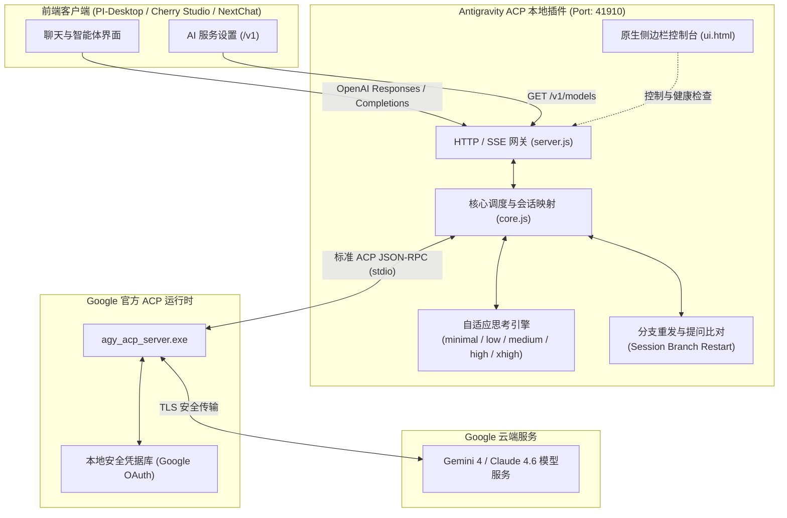

# Antigravity ACP 网关 (PI-Desktop 插件)

<p align="center">
  
</p>

<p align="center">
  <strong>将 Google 官方 Antigravity ACP 运行时无缝转换为标准 OpenAI 兼容的本地高性能 API 网关</strong>
</p>

<p align="center">
  <a href="https://github.com/sedirk/antigravity-acp-pidesktop/releases"></a>
  <a href="LICENSE"></a>
  
  
  
</p>

---

## 📑 目录

- [🌟 为什么选择 Antigravity ACP](#-为什么选择-antigravity-acp)
- [🏗️ 系统架构](#️-系统架构)
- [🚀 快速上手](#-快速上手)
  - [1. 安装插件](#1-安装插件)
  - [2. 初始化运行时与一键登录](#2-初始化运行时与一键登录)
  - [3. 在 PI-Desktop 中接入服务](#3-在-pi-desktop-中接入服务)
- [🧠 深度思考与思维链自适应体系](#-深度思考与思维链自适应体系)
  - [支持模型总览（共 8 款模型）](#支持模型总览共-8-款模型)
  - [全新 Gemini 4 Hydrogen 与 xhigh 档位](#全新-gemini-4-hydrogen-与-xhigh-档位)
  - [自适应思考工作机制](#自适应思考工作机制)
- [🛠️ 核心功能亮点](#️-核心功能亮点)
  - [打断重新编辑与分支重发保障](#打断重新编辑与分支重发保障)
  - [双向工具集成与宿主工具回交](#双向工具集成与宿主工具回交)
  - [PID 进程树清理与后台自愈](#pid-进程树清理与后台自愈)
  - [原生侧边栏管理控制台](#原生侧边栏管理控制台)
- [⚙️ 配置参数详解](#️-配置参数详解)
- [📡 API 端点规范](#-api-端点规范)
- [❓ 常见问题排查 (FAQ)](#-常见问题排查-faq)
- [🧪 本地开发与测试](#-本地开发与测试)
- [📄 开源协议](#-开源协议)

---

## 🌟 为什么选择 Antigravity ACP

Google Antigravity 官方运行时（`agy_acp_server.exe`）拥有强大的智能代理执行、深度思维链和长上下文能力。然而官方通常绑定庞大的客户端，缺少标准的 HTTP API 协议暴露。

**Antigravity ACP 网关插件**应运而生：
- 🔒 **本地私密安全**：**不逆向私有接口，不上传或劫持 Token**，所有凭据由 Google 官方二进制在本地安全保管。
- 📦 **免装官方客户端**：内置极简自动化下载与校验机制，无需在电脑上预装数十 GB 的臃肿桌面客户端。
- ⚡ **原生标准适配**：对外统一提供标准的 `/v1/responses` 与 `/v1/chat/completions` 接口，无缝接入 PI-Desktop、Cherry Studio 等生态工具。
- 🧠 **思维链自适应**：原生适配最新 **Gemini 4 Hydrogen (支持 xhigh 极限思考)**、Carbon、Argon 及 Claude 系列，自动解析并下发思考深度。

---

## 🏗️ 系统架构



---

## 🚀 快速上手

### 1. 安装插件

1. 前往 [Releases 发布页面](https://github.com/sedirk/antigravity-acp-pidesktop/releases) 下载最新版本的 `.piplug` 安装包（如 `local.antigravity-acp-2.2.0.piplug`）。
2. 在 **PI-Desktop** 中打开 **设置** → **插件**。
3. 点击右上角 **从本地安装**，选择刚下载的 `.piplug` 文件。
4. 安装完成后，插件后台将自动初始化并在默认端口 `41910` 启动网关服务。

### 2. 初始化运行时与一键登录

首次使用时，只需两步即可完成就绪：

1. **打开控制台**：在 PI-Desktop 右侧边栏中点击 **Antigravity ACP** 图标（或在插件详情中点击“打开控制台”）。
2. **下载运行时**：若“运行时状态”显示未就绪，点击顶部显目的 **一键初始化运行时** 按钮，网关将自动下载轻量级二进制文件并校验 SHA256。
3. **Google 授权登录**：点击 **一键登录 Google**，系统将自动调起默认浏览器访问 Google 官方授权页；授权成功后，状态将自动跳变为 **已就绪**。

> [!TIP]
> 插件右侧边栏内置了**一键刷新检测**与**自动检测就绪**机制，控制台打开时会自动探活，无需反复重启软件。

### 3. 在 PI-Desktop 中接入服务

进入 PI-Desktop 的 **偏好设置** → **模型** → **添加服务**：

| 参数项 | 推荐填入值 | 说明 |
| :--- | :--- | :--- |
| **服务类型** | `自定义端点` | 标准兼容模式 |
| **名称** | `gemini` 或 `Antigravity ACP` | 本地显示名称 |
| **接口地址** | `http://127.0.0.1:41910/v1` | **必须带 `/v1` 后缀** |
| **API 密钥** | `sk-local`（或任意字符） | 本地网关默认免鉴权 |
| **接口格式** | **`OpenAI Responses`** *(强烈推荐)* | 完整支持原生思维链、长会话与工具回交 |

> [!IMPORTANT]
> **关键步骤：配置完成后，请务必点击右侧的「获取列表」按钮！**
> 点击后客户端将从网关同步全部模型元数据（包括最新上线的 `gemini-4-hydrogen`、各模型的上下文规格及 `xhigh` 思考档位）。

---

## 🧠 深度思考与思维链自适应体系

### 支持模型总览（共 8 款模型）

网关启动后通过虚拟模型引擎自动归一化底层模型，提供精准的上下文与思考档位定义：

| 虚拟模型 ID | 显示名称 | 上下文大小 | 最大输出 | 思考档位支持 | 适用场景 |
| :--- | :--- | :---: | :---: | :---: | :--- |
| `gemini-4-hydrogen` | **Gemini 4 Hydrogen** *(最新)* | **1,048,576** (1M) | **65,536** (64K) | `low`, `medium`, `high`, **`xhigh`** | 极深逻辑推演、重大架构设计、超长链代码编写 |
| `gemini-4-carbon` | Gemini 4 Carbon | 1,048,576 (1M) | 65,536 (64K) | `low`, `medium`, `high` | 强推理旗舰模型、工程级代码落地 |
| `gemini-4-argon` | Gemini 4 Argon | 1,048,576 (1M) | 32,768 (32K) | `low`, `medium`, `high` | 通用对话、轻度代码、日常任务平衡之选 |
| `gemini-3.8-flash` | Gemini 3.8 Flash | 1,048,576 (1M) | 65,536 (64K) | *不支持思考* | 毫秒级极速响应、文档总结、初级筛选 |
| `claude-sonnet-4-6` | Claude Sonnet 4.6 (Thinking) | 1,000,000 (1M) | 131,072 (128K) | `low`, `medium`, `high` | 精致文学撰写、复杂指令跟随、混合思维链 |
| `claude-opus-4-6-thinking` | Claude Opus 4.6 (Thinking) | 1,000,000 (1M) | 131,072 (128K) | `low`, `medium`, `high` | 深度复杂推理、高难度综合分析 |
| `gpt-oss-120b` | GPT-OSS 120B | 131,072 (128K) | 32,768 (32K) | *不支持思考* | 开源大参数基座测试与实验对比 |

---

### 全新 Gemini 4 Hydrogen 与 xhigh 档位

Google 最新推出的 **`gemini-4-hydrogen`** 支持超高预算的深度思考（`xhigh` 极限档位）：

1. **自动聚合**：底层运行时的 `gemini-4-hydrogen` 与 `gemini-4-hydrogen-xhigh` 会被网关自动合并为一个主模型 `gemini-4-hydrogen`，不再冗余显示分裂的裸模型 ID。
2. **档位完整性**：向客户端完整导出 `low`、`medium`、`high`、`xhigh` 四档思考深度。在 PI-Desktop 的模型高级设置中可直接自由滑动选择。

### 自适应思考工作机制

网关内置的 **Adaptive Thinking Engine** 具备以下核心能力：

```
                客户端请求传入
       (reasoning_effort / thinking 档位)
                     │
                     ▼
       ┌───────────────────────────┐
       │ 检查目标模型是否支持思考能力？│
       └─────────────┬─────────────┘
                     │
           ┌─────────┴─────────┐
           ▼ 是                ▼ 否
   ┌───────────────┐     ┌───────────────┐
   │ 当前档位是否支持？ │     │ 忽略思考参数   │
   └───┬───────┬───┘     │ 以普通模型发送 │
       │ 是    │ 否      └───────────────┘
       ▼       ▼
┌───────────┐ ┌─────────────────────────────────────────┐
│直接命中档位│ │智能就近对齐降级：                       │
│(如 xhigh) │ │- 请求 xhigh 但仅支持 high -> 降级为 high │
└───────────┘ │- 请求 minimal 但仅支持 low -> 升级为 low │
              └─────────────────────────────────────────┘
```

- **协议声明**：在 `/v1/models` 输出中显式标注 `thinkingProtocol: "adaptive"`，告知前端自动启用自适应思维链，无需用户编写复杂的 Prompt 强行触发思考。
- **平滑兼容**：不管是 OpenAI Responses 的 `reasoning.effort` 还是 Chat Completions 的 `reasoning_effort`，网关均能无损提取与映射。
- **思考流实时还原**：在 SSE 响应流中以 `reasoning_content` 和 `reasoning_summary_text.delta` 格式输出，客户端思考面板实时展开。

---

## 🛠️ 核心功能亮点

### ⚡ 前缀缓存对齐（Prefix Cache Alignment）与 TPU 提速
- **工具 Schema 确定性排序**：无论客户端以何种顺序传入 tools，网关内部严格按名称进行字母排序（`pi-bridge_*`），确保工具定义的前缀在字节级绝对稳定，最大化激发云端 TPU 集群的 **Prefix Caching**（复用率提升 5~10 倍）。
- **首轮系统锚定与续会话免重复**：工具引导词只在首轮新建会话时作为固定系统锚点注入；在长轮次对话与工具回填时，网关自动跳过重复注入，既杜绝会话上下文膨胀，又保证多轮会话的 KV Cache 持续稳定命中。
- **全链路格式标准化**：全自动规范化各轮消息的换行符（统一对齐为 `\n`）与多余空行，避免因平台差异（Windows CRLF vs POSIX LF）引起 BPE 分词器分裂从而击穿云端前缀缓存。

### 打断重新编辑与分支重发保障

在实际对话中，如果回答不符合预期，用户常常会**点击停止**并**重新编辑刚刚发送的问题**（在 PI-Desktop 中表现为生成版本切换，如 `< 2 / 2 >`）。

- **传统网关的痛点**：旧会话在后台仍然挂起，重新编辑后的内容被当作追加轮次，导致上下文污染甚至报错。
- **本网关解决方案**：引入提问签名比对与分支重置引擎。当检测到相同位置的提问发生变更时，自动平滑重置旧会话并重开上下文，保证模型 **100% 完整接纳最新修改的内容**。

### 双向工具集成与宿主工具回交

- **内置工具支持**：网络搜索（Google Search）、代码环境执行等。
- **Host Tools Bridge（宿主回交）**：当 PI-Desktop 自身带有工具定义（如桌面读取、MCP 工具等）时，网关可将工具调用请求优雅交回给 PI-Desktop 宿主执行，形成强大的执行闭环。

### PID 进程树清理与后台自愈

Windows 环境下后台常驻进程（`agy_acp_server.exe` / `localharness_external.exe`）容易因为插件热重载或崩溃变为“僵尸孤儿进程”并锁死端口。
网关每次启动时通过系统底层进程树拓扑检测，**彻底终结旧进程树**，保证服务百分之百平滑自愈。

### 原生侧边栏管理控制台

适配 PI-Desktop 侧边栏微型视图与全屏视图：
- **置顶快捷区**：运行时状态检测、一键下载初始化、一键 Google 浏览器免密登录置于最醒目位置。
- **工作区智能跟随**：工作目录留空时，网关默认实时跟随 PI-Desktop 当前工作空间，执行终端命令无需手动切换路径。

---

## ⚙️ 配置参数详解

配置文件保存在插件数据目录下的 `config.json` 中，可通过右边栏控制台可视化修改：

| 配置键 | 默认值 | 可选值 / 格式 | 详细说明 |
| :--- | :--- | :--- | :--- |
| `port` | `41910` | 1024 - 65535 | 本地网关监听的 HTTP 端口 |
| `toolPolicy` | `"all"` | `"all"`, `"shell"`, `"search"`, `"none"` | 工具权限放行策略（全部放行 / 仅命令 / 仅搜索 / 纯对话） |
| `proxyMode` | `"system"` | `"system"`, `"manual"`, `"direct"` | 网络代理模式（自动探测 Windows 系统代理 / 手动 / 直连） |
| `proxyUrl` | `""` | `http://127.0.0.1:7890` | 手动代理地址（当 `proxyMode` 为 `manual` 时生效） |
| `cwd` | `""` | 绝对路径或留空 | 工作目录。**留空代表实时跟随 PI-Desktop 当前打开的项目工程** |
| `enableHostToolsBridge`| `true` | `true` / `false` | 是否开启 PI-Desktop 宿主工具直连回交 |
| `virtualModels` | `true` | `true` / `false` | 是否启用虚拟模型归一化（聚合思考档位，避免列表散乱） |
| `defaultEffort` | `"medium"` | `"minimal"`, `"low"`, `"medium"`, `"high"`, `"xhigh"` | 客户端未指定思考深度时的全局默认档位 |
| `idleTimeoutMs` | `600000` | 毫秒数值（默认 10分钟） | 后台长连接会话空闲回收超时 |

---

## 📡 API 端点规范

网关在本地启动后，完全符合标准的 RESTful 协议：

- **`GET /v1/models`**
  返回当前支持的所有模型及元数据列表。包含上下文窗口大小（`context_window`）、最大输出 Token（`max_tokens`）、思考档位数组（`thinkingLevels`）以及协议标识（`thinkingProtocol: "adaptive"`）。
- **`POST /v1/responses`**
  OpenAI Responses 流式端点，推荐在智能代理及长上下文工具交互场景使用。
- **`POST /v1/chat/completions`**
  OpenAI Chat Completions 聊天端点，兼容通用大模型客户端。
- **`GET /health`**
  网关与底层 ACP 运行时的健康探针端点。

---

## ❓ 常见问题排查 (FAQ)

### Q1: 在模型配置界面看到部分模型显示 `--- · ---`，思考模式没有出现？
> **解答**：这是因为 PI-Desktop 客户端缓存了旧的列表缓存。
> 1. 打开 **设置** → **模型** → 点击编辑你的 **Antigravity 服务**；
> 2. 点击左下角的 **「获取列表」** 按钮；
> 3. 客户端即可拉取到最新的模型上下文大小（如 1M · 64K）和 `xhigh` 思考档位支持！

### Q2: 侧边栏一直处于“检测中”，点击刷新才有反应？
> **解答**：最新版本已全面修复该问题。插件在面板挂载时会自动触发一轮无阻塞健康轮询，若后台初始化较慢，只需保持面板开启即可在就绪后自动跳绿。

### Q3: 国内环境如何配置网络代理？
> **解答**：
> 1. 如果你在系统上开启了代理软件，网关默认配置 `proxyMode: "system"` 会自动捕获 Windows 注册表中的系统代理设置。
> 2. 如果使用局域网代理或特定端口，打开侧边栏控制台，将“代理模式”改为 **手动指定**，并在下方填入 `http://127.0.0.1:你的端口`，点击保存即可即时生效。

### Q4: 如何在 Cherry Studio / NextChat 等第三方软件中使用？
> **解答**：
> 接口地址填入 `http://127.0.0.1:41910/v1`，API Key 填入 `sk-local`，格式选 OpenAI 即可。

---

## 🧪 本地开发与测试

本项目自带完整的离线模拟桩与回归测试套件，无需连接真实外网即可验证全部网关逻辑：

```powershell
# 运行离线核心测试（覆盖思考档位映射、xhigh自适应、模型聚合、分支重发等 35 项测试）
node test/run-tests.js

# 运行真实网关回归集成测试
node test/gateway-regression.js
```

---

## 📄 开源协议

本项目基于 [Apache License 2.0](LICENSE) 协议开源。
所调用的 Google 官方二进制运行时及相关商标所有权归 Google LLC 所有。本项目仅供技术研究与本地化开发桥接使用。
